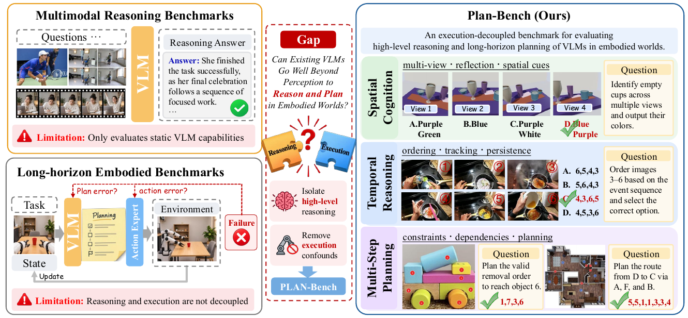
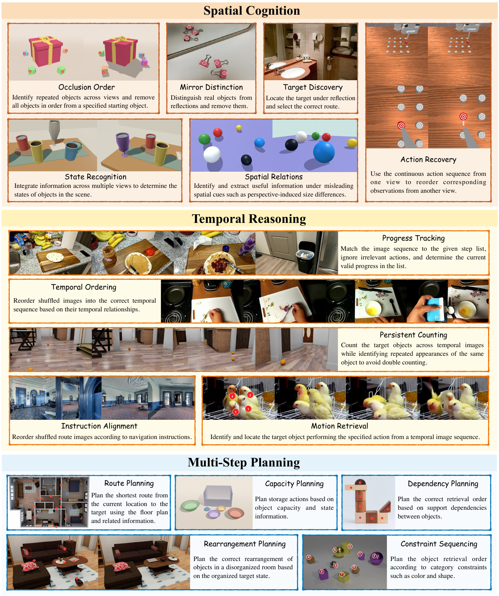
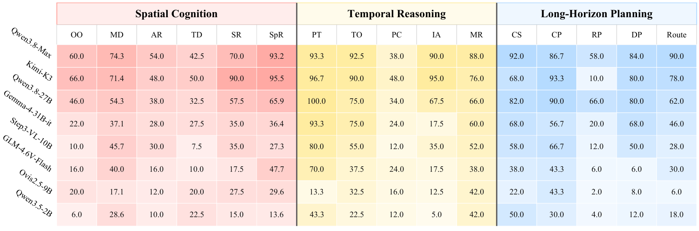
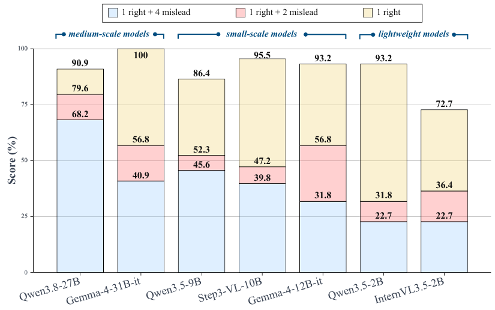
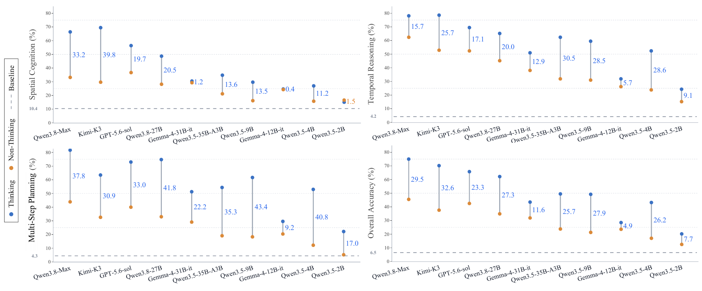

<div align="center">

# Plan-Bench

### Can Existing VLMs Go Well Beyond Perception to Reason and Plan in Embodied Worlds?

**699 Samples · 16 Subtasks · 3 Dimensions · 28 Evaluated VLMs**

[Paper](paper/plan-bench.pdf) · [Benchmark](#benchmark) · [Results](#results) · [Experimental Analysis](#experimental-analysis) · [Citation](#citation)

</div>

<!-- Add verified code and dataset URLs when available. -->



<p align="center">
  <em>Figure 1: Motivation of Plan-Bench</em>
</p>

We introduce **Plan-Bench**, a systematic benchmark for evaluating the **high-level reasoning and multi-step planning capabilities of Vision-Language Models (VLMs)** in embodied worlds. By **decoupling high-level reasoning from low-level action execution**, Plan-Bench provides a lightweight and unified framework for assessing whether existing VLMs can go beyond visual perception to reason about spatial relationships, understand temporal dynamics, and plan multi-step actions under various constraints.

## Benchmark

| Dimension | Samples | Subtasks | Focus |
| :--- | ---: | ---: | :--- |
| Spatial Cognition | 259 | 6 | Multi-view understanding and spatial ambiguity |
| Temporal Reasoning | 210 | 5 | Event order, progress tracking, and object identity |
| Multi-Step Planning | 230 | 5 | Action sequences, constraints, and dependencies |

The dataset contains **183 single-choice** and **516 open-ended** questions, with **1–16 images per sample**. It combines controlled generation and existing datasets; 699 samples are retained from 2,580 candidates through independent review by three annotators.



<p align="center">
  <em>Figure 2: Representative samples of Plan-Bench</em>
</p>

</details>

## Evaluation

VLMs receive images and a question, and return an option letter or a structured answer. **DeepSeek-V4-Flash** judges answer correctness using a reference answer and optional equivalence hints. **Hints are visible only to the judge.** Accuracy is reported per dimension and overall; human verification found agreement on all 200 sampled responses.

Open-weight models are evaluated with **VLMEvalKit** on NVIDIA A800 GPUs in BF16; commercial models use API interfaces. Prompts and model configurations are provided in Appendix B.


<!-- Add tested installation, dataset access, and evaluation commands once release paths are verified. -->

## Results

Selected results from **Table 1** of the paper. Values are accuracy (%).

| Model | Spatial Cognition | Temporal Reasoning | Multi-Step Planning | Overall |
| :--- | ---: | ---: | ---: | ---: |
| Qwen3.8-Max | 66.4 | 78.1 | **81.7** | **75.0** |
| Kimi-K3 | **69.5** | **78.6** | 63.5 | 70.2 |
| GPT-5.6-sol | 56.4 | 69.5 | 73.0 | 65.8 |
| Qwen3.8-27B | 48.7 | 65.2 | 74.8 | 62.2 |
| Qwen3.5-27B | 39.0 | 65.7 | 66.1 | 55.9 |
| Random baseline | 10.4 | 4.2 | 4.3 | 6.5 |

<details>
<summary><strong>All 28 VLMs</strong></summary>

| Model | Spatial Cognition | Temporal Reasoning | Multi-Step Planning | Overall |
| :--- | ---: | ---: | ---: | ---: |
| Qwen3.8-Max | 66.4 | 78.1 | **81.7** | **75.0** |
| Kimi-K3 | **69.5** | **78.6** | 63.5 | 70.2 |
| GPT-5.6-sol | 56.4 | 69.5 | 73.0 | 65.8 |
| Claude-Opus-4.8 | 42.5 | 49.1 | 63.5 | 51.4 |
| Gemini-3.1-Pro-Preview | 39.8 | 57.1 | 43.9 | 46.4 |
| Qwen3.8-27B | 48.7 | 65.2 | 74.8 | 62.2 |
| Qwen3.5-27B | 39.0 | 65.7 | 66.1 | 55.9 |
| Qwen3.5-35B-A3B | 34.8 | 62.4 | 54.4 | 49.5 |
| Gemma-4-31B-it | 30.5 | 51.0 | 51.3 | 43.5 |
| Qwen3-VL-30B-A3B | 22.4 | 21.9 | 15.7 | 20.0 |
| InternVL3.5-30B-A3B | 14.7 | 25.2 | 13.9 | 17.6 |
| Qwen3.5-9B | 29.7 | 59.5 | 61.7 | 49.2 |
| Step3-VL-10B | 25.1 | 43.8 | 40.9 | 35.9 |
| Gemma-4-12B-it | 24.7 | 31.9 | 29.6 | 28.5 |
| GLM-4.6V-Flash | 23.9 | 35.2 | 23.0 | 27.0 |
| InternVL3.5-8B | 19.3 | 28.1 | 12.2 | 19.6 |
| Ovis2.5-9B | 20.9 | 24.3 | 13.9 | 19.6 |
| NEO-9B-SFT | 23.6 | 19.1 | 12.6 | 18.6 |
| MiMo-VL-7B-SFT | 19.7 | 21.4 | 13.9 | 18.3 |
| SenseNova-U1 | 17.4 | 15.2 | 20.9 | 17.9 |
| Qwen3-VL-8B-Instruct | 17.8 | 19.5 | 16.5 | 17.9 |
| NEO-ov | 18.5 | 17.6 | 12.6 | 16.3 |
| Ovis2-8B | 15.1 | 19.1 | 13.0 | 15.6 |
| Qwen3.5-4B | 27.0 | 52.4 | 53.0 | 43.2 |
| Qwen3.5-2B | 15.1 | 24.3 | 22.2 | 20.2 |
| Qwen3-VL-2B-Instruct | 14.3 | 17.1 | 8.3 | 13.2 |
| InternVL3.5-2B | 13.9 | 18.6 | 5.7 | 12.6 |
| NEO-2B-SFT | 10.4 | 7.1 | 7.0 | 8.3 |
| Random baseline | 10.4 | 4.2 | 4.3 | 6.5 |

</details>

## Experimental Analysis

### Task-specific weaknesses



<p align="center">
  <em>Figure 3: Task-specific weaknesses</em>
</p>

**Overall accuracy can hide substantial weaknesses:** Qwen3.8-Max scores 75.0% overall but only **38.0% on Persistent Counting**; Kimi-K3 scores 70.2% overall but **10.0% on Rearrangement Planning**. Scaling generally helps within a model family, but task-specific performance remains important.

### Robustness to misleading views



<p align="center">
  <em>Figure 4: Robustness to misleading views</em>
</p>

**More views do not always help.** Adding four misleading views to one informative view reduces Spatial Relations accuracy from **90.9% to 68.2%** for Qwen3.8-27B, and from **93.2% to 22.7%** for Qwen3.5-2B. Robustness varies with model scale and family.

### Thinking improves planning



<p align="center">
  <em>Figure 5: Thinking improves planning</em>
</p>

Across ten models, Thinking brings average gains of **31.1 percentage points in Multi-Step Planning**, compared with 19.4 in Temporal Reasoning and 15.2 in Spatial Cognition. All ten improve overall accuracy, with longer inference time.


## Citation

The supplied manuscript is anonymous and under review at ICLR 2027. Update this entry when public publication metadata is available.

```bibtex
@misc{planbench2026,
  title  = {{Plan-Bench}: Can Existing {VLMs} Go Well Beyond Perception to Reason and Plan in Embodied Worlds?},
  author = {{Anonymous}},
  year   = {2026},
  note   = {Anonymous manuscript under review as a conference paper at ICLR 2027}
}
```

All figures are cropped directly from the [paper](paper/figures/plan-bench.pdf); extraction details are recorded in [assets/SOURCES.json](assets/SOURCES.json).
